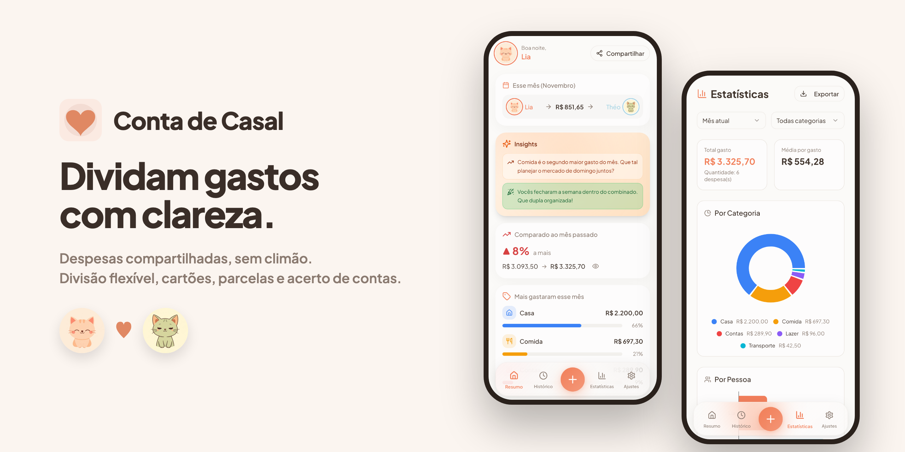
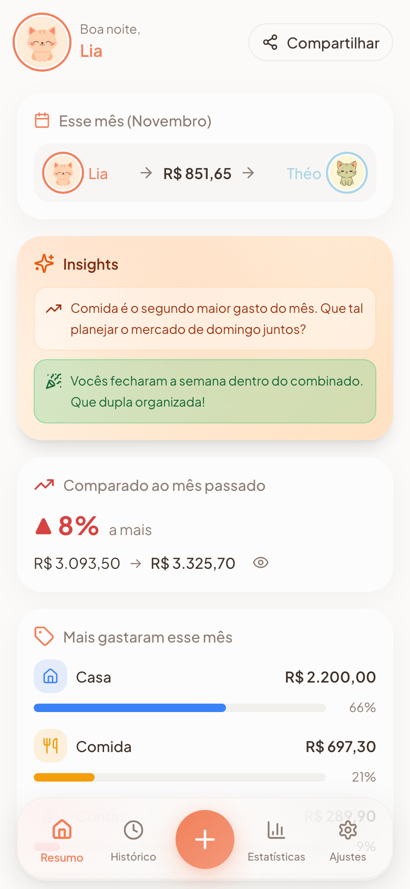
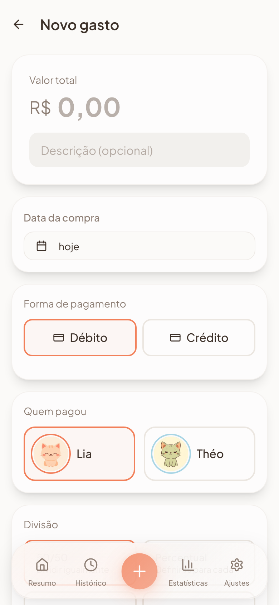
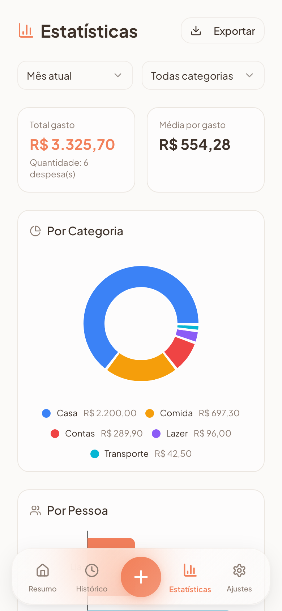

<p align="center">
  
</p>

<p align="center">
  <a href="#português">Português</a> · <a href="#english">English</a>
</p>

<p align="center">
  
  
  
  
  
</p>

---

## Português

**Conta de Casal** é um app para dividir despesas com quem você mora, sem planilha e sem climão. Cada pessoa tem seu gatinho, sua cor e seu código, e o app cuida da conta: quem pagou, quanto cada um deve e como fechar o mês.

Funciona na web e como app iOS (Capacitor).

> Projeto de portfólio. Todas as capturas usam um casal fictício, e o cartão de Insights nelas mostra textos ilustrativos, porque a IA só roda com uma chave configurada.

### Como é por dentro

<table>
  <tr>
    <td></td>
    <td></td>
    <td></td>
    <td></td>
  </tr>
  <tr align="center">
    <td>Resumo</td><td>Novo gasto</td><td>Histórico</td><td>Estatísticas</td>
  </tr>
</table>

### O que dá para fazer

- **Criar um espaço** para até 5 pessoas e convidar por código de compartilhamento.
- **Entrar com `@username` e um código de 4 dígitos**, sem e-mail obrigatório.
- **Registrar gastos** com categorias, divisão 50/50, por porcentagem, valor fixo ou integral.
- **Cartões de crédito e parcelas**, com o mês de fatura certo.
- **Acordos recorrentes** (aluguel, internet, assinaturas).
- **Estatísticas e comparação com o mês anterior**, com opção de esconder valores.
- **Acerto de contas** entre as pessoas.
- **Insights por IA** sobre os gastos, quando um provedor está configurado.
- **Português, inglês e espanhol**, com moeda configurável.

### Como a IA entra, com honestidade

**No produto.** Os insights são gerados por uma Edge Function que usa Groq ou Google AI, se houver chave configurada. Sem chave, o app mostra "nenhum insight disponível" e segue funcionando. Os cálculos de divisão e de acerto não passam por modelo de linguagem.

**No processo.** Eu idealizei o Conta de Casal e o construí com várias ferramentas de IA (Lovable, Claude e Cursor), guiando cada uma com prompts detalhados, e o histórico do Git mostra isso de forma transparente. As decisões de produto, de dados e de segurança passam por mim, e nesta fase de portfólio eu revisei e reforcei o projeto: lint, tipos, testes, correção de bugs e limpeza do repositório.

### Segurança

- **RLS no Postgres** e uma migração de reforço de segurança, com nomes de políticas padronizados.
- **Edge Functions com rate limit** por endpoint e sanitização de entrada.
- **Código pessoal protegido por hash com sal secreto** (`PIN_HASH_SALT`, que só existe no servidor), com contagem de tentativas e **bloqueio temporário** após erros.
- **Validação com Zod** no cliente e restrições no banco (por exemplo, gasto com data no futuro é recusado).
- **Headers de segurança** na Vercel: HSTS, CSP, `X-Frame-Options`, `Permissions-Policy` e políticas de origem cruzada.
- **Nada de segredo no repositório.** Só a chave pública do Supabase vai para o navegador, e `.env` está no `.gitignore`.

**Limitações conhecidas.** Um código de 4 dígitos tem só 10 mil combinações. Por isso a defesa real está no bloqueio por tentativas e no rate limit, e não no hash em si. Um próximo passo natural é usar uma função de derivação de chave lenta (como Argon2) e permitir códigos maiores.

**Dependências.** O CI roda lint, tipos, testes e build, e o Dependabot acompanha as atualizações. Dois avisos de produção seguem abertos de propósito, porque a correção exige troca de versão major e o risco prático é baixo aqui: `react-router` (redirecionamento aberto com URL externa em `<Link>`, e uma falha que só existe com renderização no servidor, que este app não usa) e `zod` (consumo de memória ao validar coleções enormes, e aqui ele só valida formulários no navegador). A migração do `zod` 3 para 4 depende de atualizar também o `@hookform/resolvers`.

### Stack

React 18, TypeScript, Vite, Tailwind CSS e shadcn/ui no front. Supabase no back (Postgres, RLS e 17 Edge Functions em Deno). Capacitor para o app iOS. Vercel para a web.

### Como rodar

Você precisa de Node 20 ou superior, Docker e a [Supabase CLI](https://supabase.com/docs/guides/local-development).

```bash
npm ci
supabase start                                   # banco local, migrações e seed
supabase status -o env                           # veja a URL e a chave ANON
cp .env.example .env.local                       # preencha com os valores LOCAIS
echo "PIN_HASH_SALT=$(openssl rand -hex 16)" > supabase/functions/.env.local
supabase functions serve --env-file supabase/functions/.env.local   # em outro terminal
npm run dev                                      # http://localhost:8080
```

Pontos importantes:

- Use sempre os valores do stack **local** em `.env.local`. Nunca aponte o ambiente de desenvolvimento para um projeto de produção.
- A CSP do `index.html` só libera `*.supabase.co`. No modo `dev`, um pequeno plugin do Vite libera também `127.0.0.1:54321`, sem afrouxar o build de produção.
- O `supabase/seed.sql` é só para ambiente local: ele concede os privilégios básicos que a plataforma na nuvem já aplica sozinha.

### Testes e qualidade

```bash
npm run check   # lint, tipos, testes e build
```

O lint e os tipos passam sem erros, e há testes unitários (Vitest) para utilitários, avatares e esquemas de validação. A cobertura ainda é pequena e é o próximo ponto a crescer, começando pelas regras de divisão e de acerto de contas.

### Estrutura

```text
src/
  pages/        telas (resumo, histórico, estatísticas, ajustes)
  components/   componentes, incluindo shadcn/ui
  contexts/     autenticação, idioma e preferências
  lib/          utilitários, validação e registro de avatares
supabase/
  migrations/   esquema versionado
  functions/    Edge Functions (Deno) e código compartilhado
docs/           workflow do repositório e análise técnica
ios/            projeto Xcode do Capacitor
```

---

## English

**Conta de Casal** ("Couple's Tab") is an app for splitting expenses with the person you live with, no spreadsheets and no awkwardness. Everyone gets their own cat, color and code, and the app handles the math: who paid, who owes what and how to close the month.

It runs on the web and as an iOS app (Capacitor).

> Portfolio project. All screenshots use a fictional couple, and the Insights card shows illustrative text because AI only runs with a configured key.

### What you can do

- **Create a space** for up to 5 people and invite them with a share code.
- **Sign in with an `@username` and a 4-digit code**, no email required.
- **Log expenses** with categories and 50/50, percentage, fixed or full splits.
- **Credit cards and installments**, with the right billing month.
- **Recurring agreements** (rent, internet, subscriptions).
- **Statistics and month-over-month comparison**, with an option to hide amounts.
- **Settle up** between people.
- **AI insights** about spending, when a provider is configured.
- **Portuguese, English and Spanish**, with configurable currency.

### How AI is used, honestly

**In the product.** Insights come from an Edge Function that calls Groq or Google AI when a key is configured. Without a key the app shows "no insights available" and keeps working. Split and settlement math never goes through a language model.

**In the process.** I came up with Conta de Casal and built it with several AI tools (Lovable, Claude and Cursor), guiding each one with detailed prompts, and the Git history shows that openly. Product, data and security decisions go through me, and in this portfolio phase I reviewed and hardened the project: lint, types, tests, bug fixes and repository cleanup.

### Security

- **Postgres RLS** and a security hardening migration with standardized policy names.
- **Edge Functions with per-endpoint rate limiting** and input sanitization.
- **Personal code protected by a salted hash** (`PIN_HASH_SALT`, server-side only), with attempt counting and **temporary lockout** after failures.
- **Zod validation** on the client and database constraints (for example, future-dated expenses are rejected).
- **Security headers** on Vercel: HSTS, CSP, `X-Frame-Options`, `Permissions-Policy` and cross-origin policies.
- **No secrets in the repository.** Only the public Supabase key reaches the browser, and `.env` is gitignored.

**Known limitations.** A 4-digit code has only 10,000 combinations, so the real defense is lockout and rate limiting, not the hash itself. A natural next step is a slow key derivation function (such as Argon2) and longer codes.

**Dependencies.** CI runs lint, types, tests and build, and Dependabot tracks updates. Two production advisories are intentionally left open because the fix requires a major version bump and the practical risk is low here: `react-router` (open redirect with an external URL in `<Link>`, and a flaw that only exists with server-side rendering, which this app does not use) and `zod` (memory use when validating huge collections, and here it only validates forms in the browser). Moving `zod` from 3 to 4 also requires updating `@hookform/resolvers`.

### Stack

React 18, TypeScript, Vite, Tailwind CSS and shadcn/ui on the front end. Supabase on the back end (Postgres, RLS and 17 Deno Edge Functions). Capacitor for the iOS app. Vercel for the web.

### Running it

You need Node 20 or newer, Docker and the [Supabase CLI](https://supabase.com/docs/guides/local-development).

```bash
npm ci
supabase start                                   # local DB, migrations and seed
supabase status -o env                           # see the URL and ANON key
cp .env.example .env.local                       # fill with LOCAL values
echo "PIN_HASH_SALT=$(openssl rand -hex 16)" > supabase/functions/.env.local
supabase functions serve --env-file supabase/functions/.env.local   # another terminal
npm run dev                                      # http://localhost:8080
```

Notes:

- Always use the **local** stack values in `.env.local`. Never point development at a production project.
- The CSP in `index.html` only allows `*.supabase.co`. In `dev` mode, a small Vite plugin also allows `127.0.0.1:54321`, without loosening the production build.
- `supabase/seed.sql` is for local use only: it grants the basic privileges the hosted platform applies on its own.

### Tests and quality

```bash
npm run check   # lint, types, tests and build
```

Lint and types pass with no errors, and there are unit tests (Vitest) for utilities, avatars and validation schemas. Coverage is still small and is the next thing to grow, starting with the split and settlement rules.

---

<p align="center">Feito por <a href="https://github.com/s1mh">Samuel Rocha</a>, estudante de Gestão de TI.</p>
